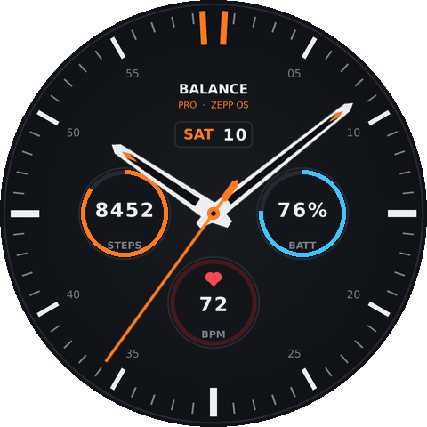
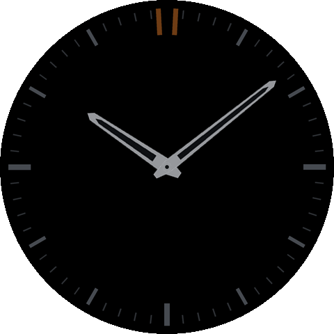

# Balance Pro — Amazfit Balance saat yüzü (Zepp OS)



Amazfit Balance (480×480 yuvarlak AMOLED, Zepp OS) için profesyonel hibrit saat yüzü.

**Özellikler**
- Analog akrep, yelkovan ve saniye ibresi (turuncu vurgu, karanlık tema)
- Tarih penceresi: gün adı + gün (`SAT 10`)
- Sol alt kadran: adım sayısı + günlük hedef ilerleme halkası
- Sağ alt kadran: pil yüzdesi + pil halkası
- Alt kadran: son nabız (BPM)
- Alt kadranlara dokununca ilgili uygulama açılır (Adım, Pil, Nabız)
- AOD (Her Zaman Açık Ekran) modu: kısık, saniye ibresiz, siyah ağırlıklı — pil dostu
- Tüm veriler sistem veri bağlamalarıyla (`data_type`) güncellenir, JS zamanlayıcısı yok → düşük pil tüketimi

| Normal | AOD |
|---|---|
|  |  |

## Proje yapısı

```
app.json                  Zepp OS uygulama yapılandırması (appType: watchface)
app.js
watchface/index.js        Saat yüzü düzeni (widget'lar)
assets/balance.r/         Derlemeye giren görseller (icon.png + images/)
tools/generate_assets.py  Tüm görselleri (kadran, ibreler, rakam fontları) üretir
tools/render_preview.py   Mağaza önizlemelerini (store/) ve ikonu üretir
store/                    Mağaza için önizleme görselleri
```

Tasarımı değiştirmek için `tools/generate_assets.py` içindeki renkleri (`ACCENT`, `WHITE`…) düzenleyip şunları çalıştırın:

```bash
pip install pillow
python3 tools/generate_assets.py && python3 tools/render_preview.py
```

## Derleme ve saatte test

```bash
npm i -g @zeppos/zeus-cli
cd amazfit-balance-watchface
npm install
zeus login          # Zepp geliştirici hesabınızla
zeus build          # dist/ altında .zab paketi üretir
zeus preview        # QR kod verir → Zepp uygulaması ile okutup saate yükleyin
```

> `zeus preview` için telefondaki Zepp uygulamasında geliştirici modunu açın:
> **Profil → Ayarlar → Hakkında**, Zepp logosuna 7 kez dokunun → **Profil → Geliştirici Modu**.
> Alternatif olarak Zepp OS Simulator ile de test edebilirsiniz.

## Zepp mağazasında (Zepp App Store) yayınlama

1. **Geliştirici hesabı:** <https://console.zepp.com> adresinden Zepp Open Platform'a kaydolun
   (bireysel geliştirici kaydı ücretsizdir; kimlik doğrulaması istenebilir).
2. **Proje oluşturun:** Konsolda *Create project → Watch face* seçin. Size verilen
   **App ID**'yi `app.json` içindeki `"appId": 1000001` yerine yazın (zorunlu — yer tutucu ID ile
   yükleme kabul edilmez). İsterseniz `"vender"` alanını da güncelleyin.
3. **Derleyin:** `zeus build` → `dist/` içindeki `.zab` dosyası.
4. **Sürüm yükleyin:** Konsolda projeye girip *Version → Upload* ile `.zab` dosyasını yükleyin.
   Desteklenen cihaz listesinde **Amazfit Balance**'ı (isterseniz Balance 2 ve diğer 480 px yuvarlak
   cihazları da) işaretleyin.
5. **Mağaza bilgileri:**
   - Ad: *Balance Pro*
   - Önizleme görselleri: `store/preview.png`, `store/preview_aod.png`
   - Kısa açıklama (TR): *Analog ibreler, tarih, adım, pil ve nabız göstergeli profesyonel hibrit saat yüzü. AOD destekli.*
   - Short description (EN): *Professional hybrid watch face with analog hands, date, steps, battery and heart rate. AOD supported.*
   - Kategori: Saat yüzü, Ücretsiz (veya ücretli — ücretli yayın için konsolda ödeme bilgileri gerekir)
6. **İncelemeye gönderin:** *Submit for review*. Onaylandıktan sonra saat yüzü Zepp uygulamasında
   **Profil → Amazfit Balance → Saat Yüzü Mağazası** içinde aranabilir ve indirilebilir hale gelir.

## Lisans

MIT
